# CloudDesk: a highly available IT helpdesk on AWS

[](https://github.com/mohammedmoizahmed/clouddesk-aws/actions/workflows/tests.yml)

CloudDesk is an IT helpdesk with a service-desk style interface: people sign in with an account that an administrator created for them, raise incidents, attach screenshots and follow them to resolution, while support agents work the queue and administrators manage users and data. It is built to put core AWS services together end to end: a private network, a load-balanced and auto-scaling web tier, a managed relational database, and an event-driven file-validation pipeline.

The application is deliberately small. The focus of the project is the infrastructure around it: how it is secured, how it recovers from a failed server, and how it scales under load.

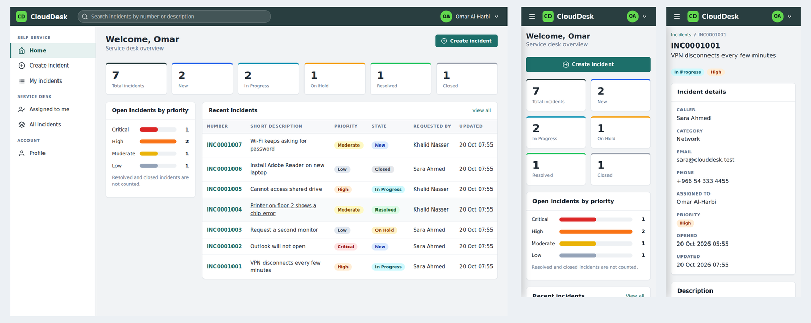
*The dashboard on desktop and on a phone. The layout adapts to phones, tablets and computers. Sample data.*

## Contents

- [The application](#the-application)
- [Architecture](#architecture)
- [Services and their roles](#services-and-their-roles)
- [How it works](#how-it-works)
- [Network design](#network-design)
- [Security design](#security-design)
- [Data layer](#data-layer)
- [Deployment](#deployment)
- [Tests and results](#tests-and-results)
- [Automated tests](#automated-tests)
- [Problems met and how they were solved](#problems-met-and-how-they-were-solved)
- [Limitations and next steps](#limitations-and-next-steps)
- [Cost control](#cost-control)
- [Repository contents](#repository-contents)

## The application

**Accounts and sign-in**

- There is no public sign-up. Only an administrator can create an account, by entering the person's name, email, phone number, role and a starting password. Without an account nobody can sign in.
- Starting passwords can be marked as temporary, so the person must choose their own the first time they sign in.
- Passwords are stored only as salted hashes, never as text. Sessions use a signed cookie that expires after 8 hours. Changing or resetting a password signs that person out of every other device.

**Three roles**

| | Requester | Agent | Administrator |
|---|---|---|---|
| Raise incidents and attach files | Yes | Yes | Yes |
| See incidents | Their own only | All | All |
| Comment | On their own incidents | On any incident | On any incident |
| Change state, priority and assignee | No | Yes | Yes |
| See the caller's email and phone | No | Yes | Yes |
| Create, edit, disable and delete users, set passwords, change roles | No | No | Yes |
| Edit any field of an incident and delete comments | No | No | Yes |
| Permanently delete incidents, with their comments and attachment files | No | No | Yes |
| View the audit log | No | No | Yes |

**Administration**

- **Users:** list, create, edit, disable or re-enable, set a new password, change a role, and delete.
- **Permanent deletes:** deleting an incident removes the row, its comments, the file in S3 and the check result in DynamoDB. Deleting a user can optionally delete all the incidents they raised. Every delete shows a confirmation page that lists exactly what will be removed.
- **Audit log:** every administrator action (who, what and when) is recorded and can be reviewed, even after the person who acted has been deleted.
- **Safeguards:** an administrator cannot demote, disable or delete their own account, so the system cannot be left without one.

**Service desk interface**

- A dashboard with counts per state, open incidents by priority and the most recent incidents.
- A list with search, filters for state and priority, sortable columns and paging.
- An incident record with numbered references (INC0001001), details, an attachment and an activity stream that records comments and every change of state, priority or assignee.
- A profile page where a user can change their password.
- A responsive layout: on a phone the navigation becomes a slide-out menu and tables become cards.

**Attachments**

Screenshots are uploaded to a private S3 bucket and checked by a Lambda function. The incident page shows the result of that check (accepted, rejected with the reason, or still being checked). Accepted images open in a pop-up viewer that closes with an X, a Back button, the Esc key or a click outside, so the file is never downloaded to the viewer's computer.

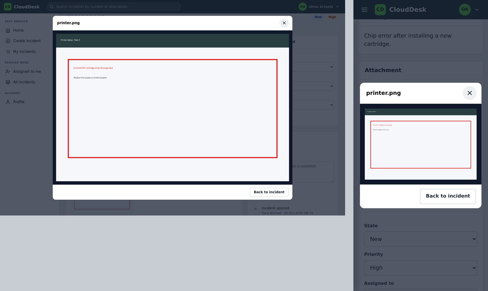
*An attachment opened in the pop-up viewer on desktop and on a phone.*

## Architecture

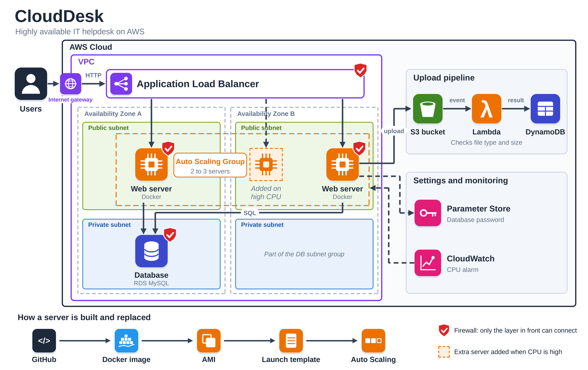
*A visitor reaches the load balancer, which sends traffic to web servers in two zones. Tickets go to the database, screenshots go to S3 and are checked by Lambda, and an alarm adds a server when CPU is high.*

In short: visitors reach an Application Load Balancer, which forwards to web servers in an Auto Scaling Group across two Availability Zones. The servers keep accounts, incidents and comments in RDS (private subnets), upload screenshots to S3, and read their settings from Parameter Store. Each upload triggers a Lambda function that validates the file and records the result in DynamoDB, which the web servers read to show that result. A CloudWatch alarm on average CPU lets the group add a third server under load.

## Services and their roles

| Service | Role in the project |
|---|---|
| VPC | Isolated network: 2 public and 2 private subnets across 2 Availability Zones |
| EC2 | Runs the application in a Docker container |
| EBS | Root volumes for every instance and AMI snapshots. A separate data volume with snapshots was used while the app ran on a single server, and was retired when the data moved to RDS |
| ELB (Application Load Balancer) | Single public entry point, health checks, spreads traffic across zones |
| Auto Scaling Group | Keeps at least 2 servers running, replaces failed ones, scales out on CPU |
| RDS (MySQL) | Shared relational storage for accounts, incidents and comments, in private subnets |
| S3 | Private storage for attachments; short-lived signed links are used to view them |
| Lambda | Triggered by S3 uploads; validates file type and size, deletes rejected files |
| DynamoDB | One record per uploaded file (accepted or rejected, reason, size, time). Written by Lambda, read by the web servers, and removed when an administrator deletes the incident |
| Systems Manager Parameter Store | Holds the database host and password and the session secret key (SecureString), fetched at boot |
| IAM | Least-privilege roles for the web servers and for the Lambda function |
| CloudWatch | Scaling alarms and metrics |

## How it works

**An incident with a screenshot**

1. The user signs in and submits the form through the load balancer.
2. A web server saves the incident in RDS and numbers it.
3. The server uploads the screenshot to S3 as `ticket-<id>/<filename>`, with its content type set from the file extension.
4. S3 triggers the Lambda function.
5. Lambda accepts files of type png, jpg, jpeg, gif, pdf or txt up to 5 MB, and rejects everything else. It writes a record to DynamoDB and deletes rejected files from S3.

**Viewing an attachment**

1. When someone opens an incident, the web server reads the file's record from DynamoDB.
2. If the file was accepted, the server creates a signed link to the S3 object that is valid for 15 minutes and tells S3 to serve it inline with the correct content type.
3. The browser shows the image in the pop-up viewer. The bucket stays private throughout.

**A new server starting**

1. The Auto Scaling Group launches an instance from the launch template and the AMI.
2. The user data script runs `startup.sh`.
3. The script reads the database host, database password and session secret key from Parameter Store (using the instance role) and starts the container.
4. The load balancer begins sending traffic once `/health` returns `OK` twice.

No secrets are stored in the image, the repository or the launch template.

## Network design

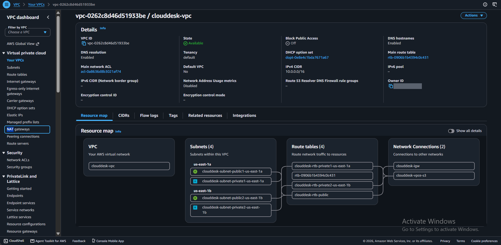
*VPC resource map: two public and two private subnets in two zones, an internet gateway and an S3 gateway endpoint. There is no NAT gateway.*

- **Public subnets** hold the load balancer and the web servers.
- **Private subnets** hold the database. They have no route to the internet.
- A **subnet group** places RDS only in the two private subnets, and the instance is not publicly accessible.
- An **S3 gateway endpoint** gives private, free access to S3 from the VPC.
- **No NAT gateway.** It bills every hour, so the web servers use public IPs to reach AWS APIs such as Parameter Store. In production they would sit in private subnets behind a NAT gateway or interface endpoints.

## Security design

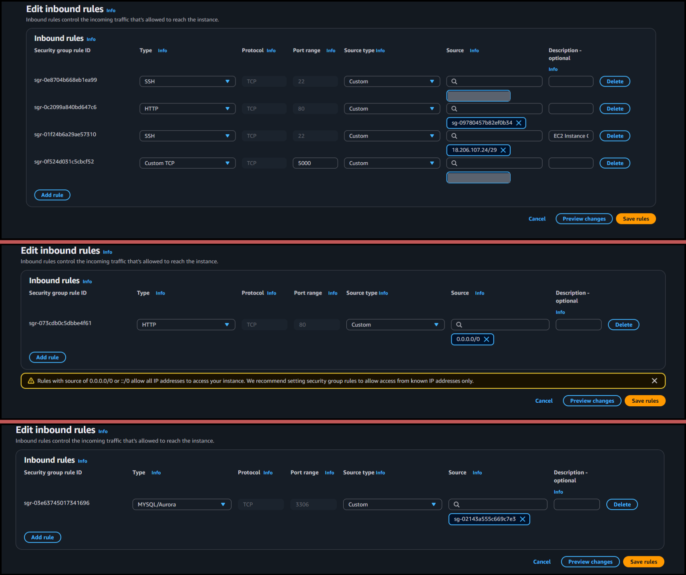
*Inbound rules for the three security groups. Personal IP addresses are redacted.*

Three security groups form a chain, and the rules reference other groups, not IP addresses:

| Group | Accepts | From |
|---|---|---|
| `clouddesk-alb-sg` | HTTP 80 | The internet |
| `clouddesk-ec2-sg` | HTTP 80 | `clouddesk-alb-sg` only |
| `clouddesk-rds-sg` | MySQL 3306 | `clouddesk-ec2-sg` only |

Because rules point at groups, new servers added by the Auto Scaling Group are allowed automatically.

**Infrastructure**

- **No credentials in code.** Servers use an IAM instance role. The instance metadata hop limit is set to 2 so that containers can use that role, and IMDSv2 is required.
- **Least privilege.** The web server role can put, get and delete objects in one bucket, read parameters under `/clouddesk/`, and read and delete items in one DynamoDB table. The delete permissions exist only so that an administrator's permanent delete also removes the stored file. The Lambda role can only write to one table and delete objects in one bucket.
- **Private bucket** with all public access blocked. Attachments are only reachable through signed links that expire after 15 minutes.

**Application**

- **Closed system.** There is no registration page. Accounts exist only if an administrator created them, and a disabled account cannot sign in.
- **Authorisation in the server.** Menus and screens differ by role, but the real checks are in the code: queries for requesters are filtered to their own incidents, other people's incidents return 404, and update requests from requesters are refused.
- **Passwords** are stored as salted hashes. Signing in with an unknown email takes about as long as a wrong password, so the response does not reveal which emails exist.
- **Request forgery protection.** Every form carries a token that is checked on submission.
- **Sessions.** The cookie is signed with a secret key held in Parameter Store, so every server accepts the same login. The cookie is HttpOnly and SameSite.
- **Safe redirects and output.** Redirects after sign-in accept only local paths, and all user text is escaped when displayed.
- **Accountability.** Administrator actions are written to an audit log, destructive actions need a confirmation page, and an administrator cannot lock themselves out.
- **Upload controls.** The app sanitises file names, forces the content type from the extension and caps request size, and Lambda validates the type and size.

## Data layer

**RDS (MySQL)** stores four tables: `users` (accounts, roles and status), `tickets` (incidents), `comments` (comments and system notes) and `audit_log` (administrator actions). Moving from a local SQLite file to RDS was required for Auto Scaling: a file on one server cannot be shared by several, and users would see different data depending on which server answered. The application creates its tables and adds any missing columns at startup, so an older database is upgraded automatically.

**DynamoDB** stores the result of each file check.

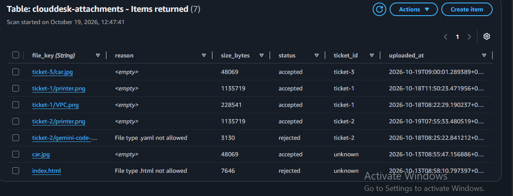
*Accepted and rejected uploads recorded by the Lambda function, including the reason for each rejection.*

**Parameter Store** holds the database host (String), the database password (SecureString) and the session secret key (SecureString).

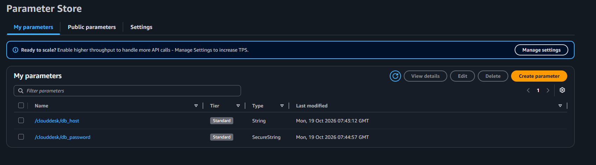
*Secrets are stored as SecureString parameters and are never written to the repository or the image.*

## Deployment

The application runs in Docker so that every server runs the identical image.

```bash
git clone https://github.com/mohammedmoizahmed/clouddesk-aws.git
cd clouddesk-aws
docker build -t clouddesk .
bash startup.sh
```

`startup.sh` is what each new server runs at first boot:

```bash
#!/bin/bash
get() { aws ssm get-parameter --region us-east-1 --name "$1" --with-decryption --query Parameter.Value --output text; }
DB_HOST=$(get /clouddesk/db_host)
DB_PASSWORD=$(get /clouddesk/db_password)
SECRET_KEY=$(get /clouddesk/secret_key)
docker rm -f clouddesk 2>/dev/null
docker run -d --name clouddesk --restart unless-stopped -p 80:5000 \
  -e DB_HOST="$DB_HOST" -e DB_USER=admin -e DB_PASSWORD="$DB_PASSWORD" -e DB_NAME=clouddesk \
  -e SECRET_KEY="$SECRET_KEY" clouddesk
```

**First use.** Because there is no sign-up page, the first administrator is created from the command line inside the running container (or an existing account is promoted):

```bash
docker exec -it clouddesk python manage.py create-user
docker exec -it clouddesk python manage.py set-role you@example.com administrator
```

After that, administrators create every other account from the site. The same tool also resets a forgotten administrator password: `docker exec -it clouddesk python manage.py set-password you@example.com`.

**Image and template**

- A server was built by hand, tested, then captured as an **AMI** with the app image already built inside it.
- The running container and shell history were removed before the image was taken, so no secrets are captured.
- The **launch template** defines the AMI, instance size, security group, instance role, metadata options and the user data that runs `startup.sh`.

**Load balancer and Auto Scaling Group**

| Setting | Value |
|---|---|
| Load balancer | Internet-facing Application Load Balancer, HTTP:80, in both public subnets |
| Target group | Health check on `/health` (a page that does not touch the database, so a database blip does not cause every server to be replaced) |
| Auto Scaling Group | Minimum 2, desired 2, maximum 3, across both zones |
| Scaling policy | Target tracking on average CPU utilisation at 50 percent |
| Health checks | Load balancer health checks enabled, so a server failing `/health` is replaced |

## Tests and results

The failover and scaling tests below were run on the first version of the application, which had a simpler interface and no accounts. The infrastructure is unchanged in the current version, apart from one extra Parameter Store value (the session secret key) and one extra read permission on the DynamoDB table.

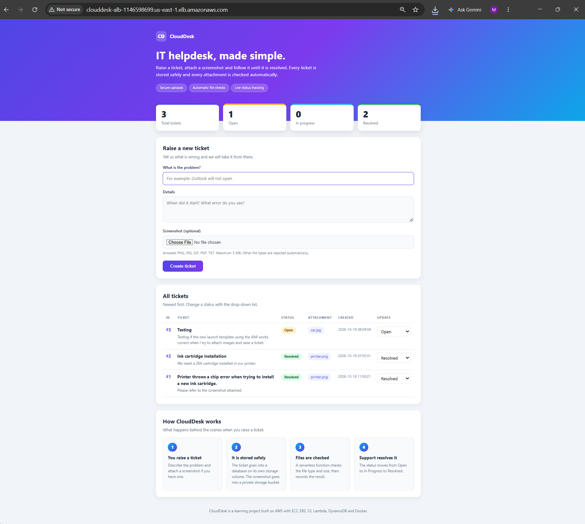
*The first version of the app loaded from the load balancer's DNS name.*

### 1. Failover: a server is lost

I terminated one server by hand to see whether the group would recover without help. The group noticed, launched a replacement in the other slot, and the load balancer registered it.

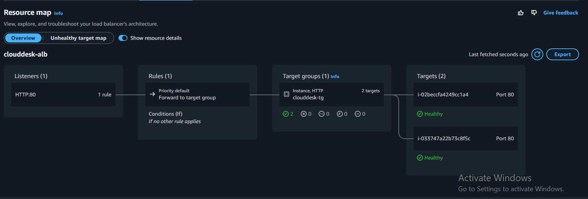
*Before: two healthy targets.*

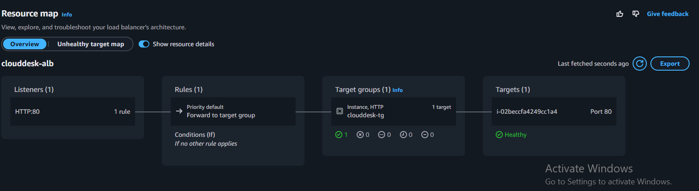
*A server is terminated; one healthy target remains and the site stays up.*

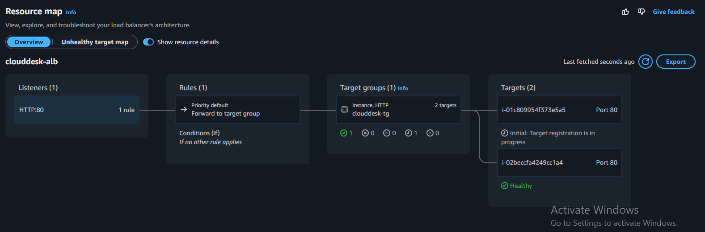
*The replacement is launched and registers with the target group (status Initial), then becomes healthy.*

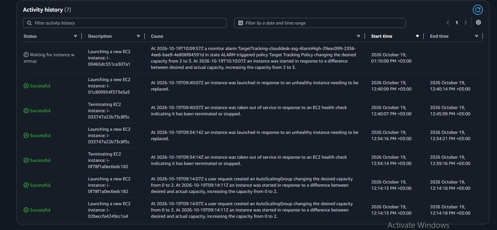
*Activity history: each termination is followed by a launch of a replacement.*

| Time (UTC+3) | Event |
|---|---|
| 12:14 | Group created; two servers launched (desired capacity 0 to 2) |
| 12:34 | First server terminated; replacement launched within seconds |
| 12:40 | Second server terminated; replacement launched within seconds |

A replacement was healthy and receiving traffic within about four minutes of launch, which is the time the instance and the boot script need.

### 2. Scale-out under load

I ran a CPU-bound process on both servers to push average CPU above the 50 percent target.

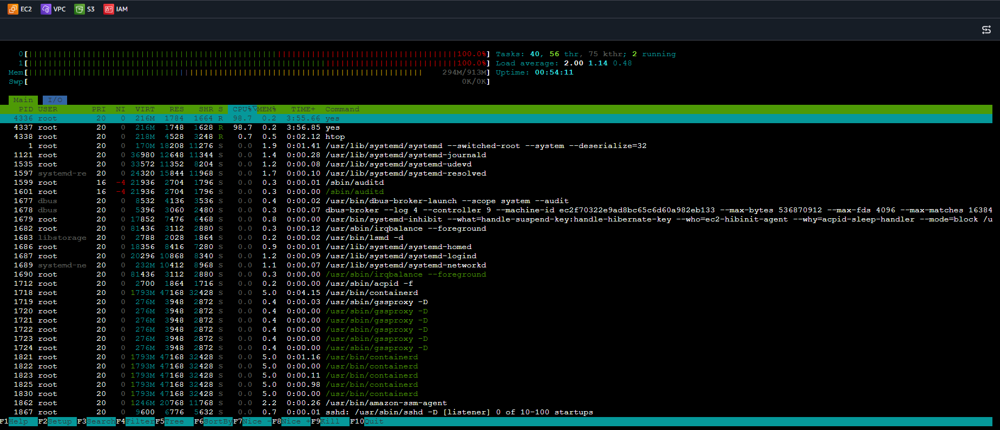
*Both cores at 100 percent on a server.*

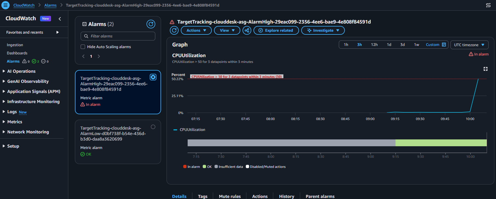
*The target-tracking alarm (CPU above 50 for 3 datapoints within 3 minutes) moves to In alarm.*

The group responded by raising the desired capacity from 2 to 3 (the last entry in the activity history above), and the third server joined the load balancer.

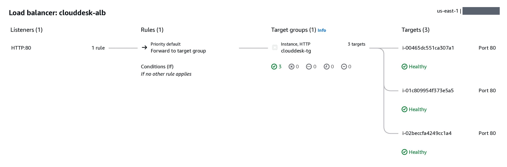
*After scale-out: three healthy targets behind the load balancer.*

## Automated tests

About 200 automated tests run against a real MySQL database on every push, using GitHub Actions. They cover:

- Sign-in, sessions, forced and voluntary password changes, disabled accounts, request-forgery tokens and blocked open redirects, and that no registration route exists.
- Permissions: requesters cannot see, comment on or change other people's incidents, agents can see everything, and only administrators can reach any administration page or action.
- Administration: creating, editing, disabling and deleting users, password resets that sign people out, permanent incident deletion that also removes the stored file, incident editing, and the audit log.
- Incident creation, numbering, filtering, sorting, searching and paging.
- Uploads: file names, content types and size limits.
- Attachment links: signed, short-lived, inline, and never offered for file types that could run code.
- Upgrading a database created by the first version of the app.
- The pop-up image viewer, driven in a real Chromium browser at desktop and phone sizes. It checks that the X, the Back button, the Esc key and a click outside all close it, and that nothing is ever downloaded.

AWS calls (S3 and DynamoDB) are replaced by in-memory fakes. The tests refuse to run unless the database name contains the word `test`, so they cannot touch real data.

Run them locally:

```bash
docker run --name clouddesk-test-db -e MYSQL_ROOT_PASSWORD=root -p 3306:3306 -d mysql:8.0
pip install -r requirements.txt -r requirements-dev.txt
python -m playwright install chromium      # only needed for the browser tests
TEST_DB_PASSWORD=root pytest
```

On Windows PowerShell, set the password first with `$env:TEST_DB_PASSWORD="root"`, then run `pytest`. Wait about 20 seconds after starting the database container.

The first run of this suite found a real bug, described in the next section.

## Problems met and how they were solved

| Problem | Cause | Fix |
|---|---|---|
| Browser-based EC2 Instance Connect could not connect | The security group allowed SSH only from my IP, but the console connects from an AWS service address range | Allowed SSH from the EC2 Instance Connect range for the region |
| A new EBS volume was far larger than intended | A default size was left in place | Checked with `lsblk` before formatting, detached it and created the right size |
| Tickets seemed to vanish after a restart | The `/etc/fstab` entry was missing its `UUID=` prefix, so the data volume was never mounted, and `nofail` hid the error. The app wrote to an empty folder on the root disk | Mounted the original volume, corrected `fstab`, recreated the container. Tested by rebooting |
| Unmount failed with "target is busy" | My own shell was inside the mounted folder | Changed directory before unmounting |
| Container could not start a second time | A container with the same name already existed | Removed it before running, and put `docker rm -f` in the start script |
| Database password sat in a file on the server | Quick first approach | Moved to Parameter Store with an instance role, and deleted the file before making the AMI |
| Local database could not be shared across servers | SQLite is one file on one disk | Migrated to RDS |
| Image attachments downloaded instead of opening | S3 stored them as generic binary files, so the browser saved them | The signed link now sets the content type and inline display, and a pop-up viewer shows the image on the page |
| The database slowly collected duplicate indexes | The start-up code added a unique index every time the app started, and MySQL does not object, so each restart added another until the limit of 64 | The index is now added only if it is missing. A regression test starts the app repeatedly and checks that exactly one index exists. Found by the automated tests |

## Limitations and next steps

- **HTTP only.** Passwords, including the ones an administrator sets for other people, travel unencrypted between the browser and the load balancer, so real users should not be given accounts until this is fixed. Add HTTPS with an ACM certificate and a custom domain, redirect port 80, and mark the session cookie as Secure.
- **No self-service password reset.** An administrator sets a new password from the Users page. Emailed reset links would need an email service such as Amazon SES.
- **No limit on sign-in attempts.** Add rate limiting or lockout, for example with AWS WAF on the load balancer.
- **Database user.** The app connects as the master user. A dedicated user with limited privileges would be better, and RDS could manage the password through Secrets Manager.
- **Database availability.** RDS is single-AZ. Enabling Multi-AZ would remove it as a single point of failure.
- **Servers in public subnets.** Done to avoid NAT gateway cost. A production design would use private subnets.
- **Updates need a new image.** The app is baked into the AMI. A better pipeline would push images to ECR and roll them out with an instance refresh, driven by GitHub Actions.
- **Minor.** The AMI contains a harmless `fstab` entry for the retired data volume, marked `nofail`.

## Cost control

- A budget alert was set before any resources were created.
- Resources that bill by the hour (RDS, the load balancer and extra instances) were created in short sessions and removed or stopped afterwards.
- No NAT gateway and no Multi-AZ database, to keep the bill small.

## Repository contents

```
app.py                  Flask application: sign-in, roles, incidents, attachments, administration
manage.py               Command-line tool to create the first administrator and reset passwords
templates/              Page templates: layout, sign in, dashboard, incidents, profile, administration
static/style.css        Responsive stylesheet
requirements.txt        Python dependencies
Dockerfile              Container image definition
startup.sh              Boot script: reads settings from Parameter Store, starts the container
lambda/                 Lambda function that validates uploads
tests/                  Automated tests (pytest)
pytest.ini              Test configuration
requirements-dev.txt    Test dependencies
.github/workflows/      GitHub Actions workflow that runs the tests on every push
docs/images/            Screenshots and diagrams used in this README
```
